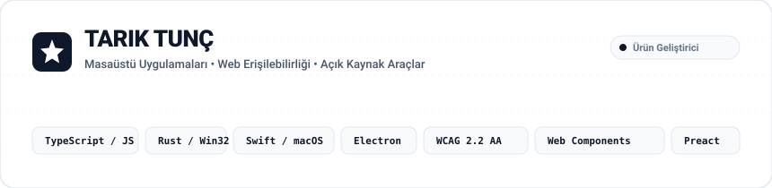

  <picture>
    <source media="(prefers-color-scheme: dark)" srcset="assets/banner-dark.svg">
    <source media="(prefers-color-scheme: light)" srcset="assets/banner-light.svg">
    
  </picture>

> **Masaüstü Araçları, Web Bileşenleri ve Açık Kaynak Projeler**  
> Electron, Rust ve Swift ile yerel masaüstü uygulamaları; web standartlarına (WCAG 2.2 AA, EAA 2025, KVKK/GDPR) tam uyumlu hafif bileşenler geliştiriyorum.

---

## Projeler ve Araçlar

| Proje | Ne İşe Yarar? | Altyapı | Bağlantılar |
|---|---|---|---|
| **Polaris** | Akıllı ekran kaydı ve kurgu aracı. Otomatik tıklama zoom'u, 120 Hz imleç yumuşatma, dinamik kamera balonu ve kayıpsız WASAPI çift kanal ses senkronu. Tamamen çevrimdışı çalışır. | `TypeScript` `Electron` `Rust` `Swift` `FFmpeg` | [İndirme Sayfası](https://tariktunc.github.io/polaris-app/) [v0.1.0-beta Sürümü](https://github.com/tariktunc/polaris-app/releases/tag/v0.1.0-beta) [GitHub Reposu](https://github.com/tariktunc/polaris-app) |
| **Accessibility Widget** | WCAG 2.2 AA ve EAA 2025 uyumlu yerel kullanıcı tercih paneli. Sahte kaplama (overlay) içermez; 7 erişilebilirlik tercihi, 9 dil ve işletim sistemi ayarlarına tam uyum. | `Preact` `Web Components` `Shadow DOM` `WCAG 2.2 AA` | [Canlı Demo](https://tariktunc.github.io/accessibility-widget/) [Dokümantasyon](https://github.com/tariktunc/accessibility-widget) [NPM Paketi](https://www.npmjs.com/package/@blakfy/accessibility-widget) |
| **Blakfy Cookie Consent** | KVKK, GDPR ve CCPA uyumlu, sıfır bağımlılıklı çerez onay aracı. 23 dil desteği, 18 hazır stil şablonu ve otomatik script engelleme (tag-gating). | `Vanilla JS` `CSS Variables` `Tag-Gating` | [Dokümantasyon](https://github.com/tariktunc/blakfy-cookie) |
| **NexusDeck** | Masaüstü iş akışı ve üretkenlik aracı. Arka planda sessiz otomatik güncelleme ve Ed25519 imza doğrulaması. | `Rust` `Win32 API` `Ed25519` `Auto-Update` | [Sürümler ve İndir](https://github.com/tariktunc/nexusdeck-releases/releases/latest) [Sürüm Reposu](https://github.com/tariktunc/nexusdeck-releases) |
| **Blakfy Footer** | Web siteleri için çok dilli, yasal mevzuata uygun künye ve alt bilgi bileşeni. | `JavaScript` `Custom Elements` `Responsive` | [Dokümantasyon](https://github.com/tariktunc/blakfy-footer) |

---

## Mimari ve Standartlar

* **Çevrimdışı ve Cihaz Üstü (Offline-First)**: Kullanıcı verisini sunuculara göndermeden, düşük kaynak tüketimiyle doğrudan bilgisayarınızda çalışan araçlar.
* **Standartlara Tam Uyum**: Yapay zeka aldatmacaları veya sahte kaplamalar (overlay) yerine W3C WCAG 2.2 ve yasal gizlilik kurallarına doğrudan uyum.
* **Modern Web + Native Performans**: Arayüzde hafif web bileşenleri; sistem seviyesi işlevlerde Rust ve Swift yerel modülleri.

---

## İletişim

* **E-Posta**: [info@blakfy.com](mailto:info@blakfy.com)
* **GitHub**: [@tariktunc](https://github.com/tariktunc)
* **Telif Hakkı**: (c) 2026 Tarık Tunç. Tüm hakları saklıdır.
